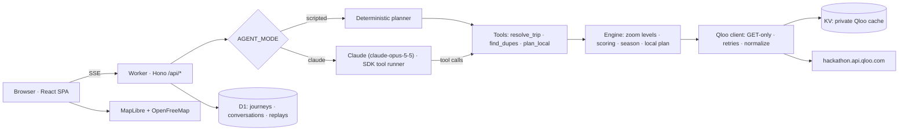

# Architecture

Elsewhere is one Cloudflare Worker. It serves the React app as static assets and the API under `/api/*`. The agent streams its work to the browser as server-sent events.

## Request flow

1. `POST /api/journeys` validates the trip with Zod and opens an SSE stream.
2. The agent works in one of two modes:
   - the scripted planner;
   - Claude with three tools: `resolve_trip`, `find_dupes` and `plan_local`.
3. Every tool call streams to the agent trace: progress steps (`trace.step`), result cards (`ui.*`) and Qloo evidence records (`evidence`).
4. The journey snapshot, the conversation and the event log are saved to D1. Saved journeys power share links (`/j/:id`) and replays.
5. `POST /api/journeys/:id/plan` plans a chosen alternative. `POST /api/journeys/:id/messages` handles free-form follow-ups (Claude mode only).

## Qloo usage

| Feature | Endpoint and parameters |
| --- | --- |
| Resolve destination, sights, favorites | `GET /search` with `types`, `filter.location` (lat,lon), `filter.radius`, `sort_by=popularity` |
| Vibe words → tags | `GET /v2/tags` with `filter.query`, `feature.semantic_search` |
| Quiet twins in the same city | `GET /v2/insights` with `filter.type=urn:entity:place`, `signal.interests.entities=<crowded spot>`, `filter.location=<city>`, `filter.popularity.max`, `filter.exclude.entities`, `filter.tags` |
| Day trips | Same as quiet twins, plus `filter.location=POINT(lon lat)`, `filter.location.radius`, `filter.exclude.location=<city>`; results grouped by town |
| Twin cities | `filter.type=urn:entity:locality` with locality signals (Qloo's multi-destination recipe) |
| Personal taste fit | `signal.interests.entities=<favorites>` + `signal.interests.tags=<vibes>` + `filter.results.entities=<candidates>` |
| Where your taste concentrates | `filter.type=urn:heatmap` with `filter.location=<city>` and taste signals |
| Season | Locality tags: `peak_tourism_month`, `off_season_month`, `best_month_for_travel`, `{month}_event` |
| Shared character | Entity tags, plus `GET /v2/analysis/compare` when tags alone find too few |
| Crowd calendar | `GET /v2/trending` with `filter.type=urn:entity:locality`, one locality signal and the past year's `filter.start_date` / `filter.end_date`; drawn over the month tags, and hidden if the endpoint doesn't answer |

All requests are GET with parameters in the query string, sent to `https://hackathon.api.qloo.com` with the `X-Api-Key` header. Responses are cached privately in Workers KV for seven days. The repository contains no Qloo data.

## Dupe Score

The score is computed in code, never by the language model. Weights per zoom level:

| Component | Same city | Day trip | Same country / Beyond borders |
| --- | --- | --- | --- |
| Soul match: Qloo affinity to the crowded original | 0.40 | 0.35 | 0.40 |
| Your taste: Qloo affinity to your favorites and vibes | 0.30 | 0.30 | 0.30 |
| Crowd relief: popularity percentile drop | 0.25 | 0.20 | 0.20 |
| Proximity: distance from the original | 0.05 | 0.15 | — |
| Season fit: Qloo month tags vs. travel month | — | — | 0.10 |

A missing component is dropped and the remaining weights are renormalized.

Crowd relief compares tail shares. The 99.5th popularity percentile leaves 0.5% above it and the 62nd leaves 38%, a 76× ratio. The score is `log10(ratio) / 2`, capped at 1.

Popularity is Qloo's cultural-attention percentile, not a visitor count, so the interface never claims crowd sizes.

## Modes

| Variable | Values | Effect |
| --- | --- | --- |
| `QLOO_MODE` | `mock` / `live` | `live` uses the real API when `QLOO_API_KEY` is set. `mock` uses a synthetic demo world: invented popularity values and taste vectors, with no Qloo data. |
| `AGENT_MODE` | `scripted` / `claude` | `claude` runs the language-model agent when `ANTHROPIC_API_KEY` is set. `scripted` runs the same tools in a fixed order with template narration. |

Both fall back safely, so the app runs end-to-end without any keys.

## Responsible use

- Only public cultural entities and a travel month are sent to Qloo. No personal data is sent.
- Results are presented as aggregate affinities. Qloo data is kept separate from interpretation, and every number links to its source field.
- "Spread, not shift": levels 1–2 keep visitors in the same destination. Small communities, detected from the locality `population` field, get a "visit gently" note.
