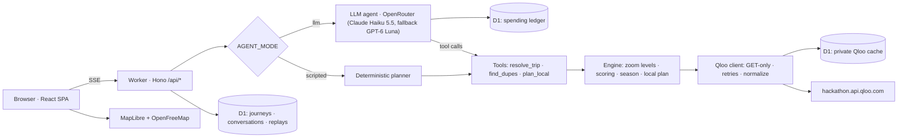

# Architecture

Elsewhere is one Cloudflare Worker. It serves the React app as static assets and the API under `/api/*`. The agent streams its work to the browser as server-sent events.

## Request flow

1. `POST /api/journeys` validates the trip with Zod and opens an SSE stream.
2. The agent works in one of two modes:
   - the scripted planner;
   - an LLM tool-calling loop over OpenRouter's chat completions API, with three tools: `resolve_trip`, `find_dupes` and `plan_local`. The model calls the zoom levels in parallel, and its last allowed call must answer in words. Text it writes before a tool call is kept in the conversation but not shown, since the trace already shows the tools.
3. Every tool call streams to the agent trace: progress steps (`trace.step`), result cards (`ui.*`) and Qloo evidence records (`evidence`).
4. The journey snapshot, the conversation and the event log are saved to D1. Saved journeys power share links (`/j/:id`) and replays.
5. `POST /api/journeys/:id/plan` plans a chosen alternative. `POST /api/journeys/:id/messages` handles free-form follow-ups (LLM mode only).

## Qloo usage

| Feature | Endpoint and parameters |
| --- | --- |
| Resolve the destination | `GET /search` with `types=urn:entity:destination` (English name, country, a popularity that compares destinations). English names Qloo files under the local one ("Venice" → "Venezia") go through a small exonym table. |
| Crowded sights | `GET /v2/insights` with `filter.type=urn:entity:place`, a circle around the city (`filter.location=POINT(lon lat)`, `filter.location.radius`) and `filter.tags=urn:tag:category:place:tourist_attraction`. Must-sees are matched to this list by name: its IDs are the ones insights accepts as signals. A search-only stub (no popularity) stands in through the nearest popular sight of the same category, for example Fushimi Inari Taisha → its Senbon Torii gates. |
| Favorites and vibe words | `GET /search` over film, TV, music, people, books and brands; `GET /v2/tags` with `filter.query`, `feature.semantic_search` and `filter.parents.types=urn:entity:place` |
| Seasons | The city's locality (`GET /search` with `types=urn:entity:locality`, run in the background because boundary polygons make it slow), then its month tags through `GET /v2/insights` with `filter.type=urn:entity:locality` and `filter.results.entities=<locality>`: `peak_tourism_month`, `best_month_for_travel`, `off_season_month`, `worst_month_for_travel`, `{month}_event`, `{month}_travel_advisory`. Search results carry no month tags. |
| Quiet twins in the same city | `filter.type=urn:entity:place`, `signal.interests.entities=<crowded spot>`, the city circle, `filter.tags=<the spot's own categories>` (a shrine's twins are shrines), `filter.popularity.max` just under the spot's, `filter.exclude.entities` |
| Day trips | `filter.type=urn:entity:destination` with the home destination as signal inside a 120 km circle. Towns at least 15 km out that share a Qloo genre with home and are not busy in their own right get their places from one query over a `MULTIPOLYGON` of circles around them (`filter.location` takes any WKT). If too few qualify, places within 120 km, grouped by the town their address names, fill in. |
| Twin cities | `filter.type=urn:entity:destination` with the home destination as signal (`take=50`, plus a second page for the world level), split by `properties.geocode.country_code`. Wards and duplicate entries are merged into their city, which takes the cluster's highest popularity. Candidates within 100 km, busier than home or below the 15th popularity percentile are dropped. Each twin's sights must sit in it, and their country corrects the odd mislocated entry (Batam filed under Singapore). Abroad, each further twin from a country already listed is discounted. |
| Personal taste fit | `signal.interests.entities=<favorites>` + `signal.interests.tags=<vibes>` + `filter.results.entities=<candidates>`, for places and destinations alike |
| Where your taste concentrates | `filter.type=urn:heatmap` around the city with taste signals |
| Shared character | Destination genres ("Art & Culture", "Beaches", "Snow and Ski") shared with home, place tags, and `GET /v2/analysis/compare` between destinations with transport and demographic tags filtered out |

All requests are GET with parameters in the query string, sent to `https://hackathon.api.qloo.com` with the `X-Api-Key` header. Qloo always returns full payloads (a city's boundary polygon alone can run to hundreds of kilobytes), so the client trims every response to the fields the engine reads before caching it, and identical requests in flight at the same time share one call. Trimmed responses are cached privately in D1 for 60 days; the repository contains no Qloo data. On the Workers Free plan D1 allows 100,000 row writes a day (KV allows 1,000) but only 50 queries per invocation, so lookups made together share one query, new responses are written alongside the next lookup or at the end of the run, and the cache stops at 24 queries, leaving the rest for journeys and the spending ledger.

On cached responses a journey takes about 5–10 ms of CPU in a warm isolate (`scripts/cpu-bench.ts`), within the Workers Free plan's 10 ms limit; waiting on Qloo and the model does not count.

## Dupe Score

The score is computed in code, never by the language model. Weights per zoom level:

| Component | Same city | Day trip | Same country | Beyond borders |
| --- | --- | --- | --- | --- |
| Soul match: Qloo affinity to the crowded original | 0.40 | 0.30 | 0.30 | 0.30 |
| Character: Qloo destination genres shared with the original | — | 0.15 | 0.25 | 0.25 |
| Your taste: Qloo affinity to your favorites and vibes | 0.30 | 0.25 | 0.25 | 0.25 |
| Crowd relief: popularity percentile drop | 0.25 | 0.15 | 0.20 | 0.20 |
| Proximity: distance from the original | 0.05 | 0.15 (to 120 km) | 0.10 (to 1,500 km) | 0.10 (to 5,000 km) |
| Season fit: Qloo month tags vs. travel month | — | — | 0.10 | 0.10 |

A missing component is dropped and the remaining weights are renormalized. Destination entities carry no month tags, so season fit usually drops out for twin cities.

Crowd relief compares tail shares. The 99.5th popularity percentile leaves 0.5% above it and the 62nd leaves 38%, a 76× ratio. The score is `log10(ratio) / 2`, capped at 1. For towns and twin cities it tops out at 10× (a tenth of the original's attention is quiet enough; a more obscure place is not better for it), and destinations above the 90th percentile are capped as busy in their own right, so London never counts as an escape from Barcelona.

Popularity is Qloo's cultural-attention percentile, not a visitor count, so the interface never claims crowd sizes.

## Modes

| Variable | Values | Effect |
| --- | --- | --- |
| `QLOO_MODE` | `mock` / `live` | `live` uses the real API when `QLOO_API_KEY` is set. `mock` uses a synthetic demo world: invented popularity values and taste vectors, with no Qloo data. |
| `AGENT_MODE` | `scripted` / `llm` | `llm` runs the language-model agent when `OPENROUTER_API_KEY` is set. `scripted` runs the same tools in a fixed order with template narration. |
| `LLM_MODEL`, `LLM_FALLBACK_MODELS` | OpenRouter model IDs | The agent's model and the fallbacks OpenRouter tries when its providers fail. |
| `LLM_DAILY_USD`, `LLM_TOTAL_USD` | dollars | Spending caps, checked against a ledger in D1 before every model call. Past either cap the scripted planner answers, and the agent trace says why. |
| `LLM_TURNS_PER_VISITOR` | number | Agent turns one visitor may start per UTC day (the visitor is a hashed client address, counted in D1). One turn costs about $0.002, so this bounds a single visitor to about $0.08 a day whatever the shared key allows. |
| `LLM_MAX_CALLS` | number | Model calls per agent turn; each tool round trip is one call. |

`cf dev --mode live` (`npm run dev:live`) sets `QLOO_MODE=live` and `AGENT_MODE=llm` and reads the keys from `.dev.vars.live`. Every other mode, including a plain deploy, runs on synthetic data with the scripted planner, so the app runs end to end without any keys.

## Responsible use

- Only public cultural entities and a travel month are sent to Qloo. No personal data is sent.
- Results are presented as aggregate affinities. Qloo data is kept separate from interpretation, and every number links to its source field.
- "Spread, not shift": levels 1–2 keep visitors in the same destination. Small communities get a "visit gently" note when Qloo provides a population (the synthetic world does; live destinations mostly don't).
